# Lava Sumo: product case study

**A Product Owner shipping a real-time multiplayer browser game with AI coding agents.**

*By Weerawish (Ben), Product Owner.*

[▶ Play it](https://bestwwr.github.io/splash-sumo/) · [Product spec](../../SPEC.md) · [Decision log](../../DECISIONS.md) · [Source](../../packages)

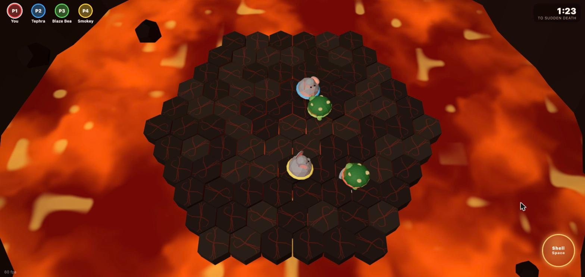

---

## TL;DR (60-second read)

| | |
|---|---|
| **What** | A mobile-first party game: up to 4 players shove each other into lava on a floor that collapses tile by tile. No install, no sign-up. Open a link and play in 90 seconds. |
| **My role** | Product Owner. I owned the vision, the spec, every product decision, the playtests and the release calls. AI coding agents (Claude Code) wrote the code under that direction. |
| **Shipped** | Solo mode against bots at 3 difficulty levels: **live on the web**. Online multiplayer with private rooms: **live**, released after phone playtests in a separate test environment. |
| **Scale of work** | 58 commits · ~10k lines of TypeScript · **229 automated tests** · 600-match simulations to balance fighters · 2 environments (test and live) |
| **Constraints** | 1 person, part-time, **$0 hosting budget**, no engineer, no artist |
| **How I worked** | Spec → recorded decisions → small reviewed tasks → playtest → measure → iterate. Every trade-off is written down with its reason, in [`DECISIONS.md`](../../DECISIONS.md). |

---

## 1. The problem and the bet

Party games like *Fall Guys* or *Stumble Guys* are fun with friends, but getting a group into one game takes an app download, accounts and a friend list. Most groups give up before the first round.

**The bet:** the fastest path from "we should play something" to playing is **a link**. One person sends it in the group chat, everyone taps it, and they're in the same match in under a minute, on whatever phone they have.

**Target users:** friend groups in a chat (students, coworkers on a break) who want a 2-minute game together, on phones, often on cellular data.

**What success looks like** (set before building, in [`SPEC.md`](../../SPEC.md) §1.3):

| Kind | Target |
|---|---|
| Ease | Link to playing in **≤ 2 taps**, no sign-up |
| Feel | **60 fps** on a mid-range phone; smooth at ≤ 120 ms network delay |
| Fairness | The server decides every collision and elimination, so no player's phone can cheat |
| Cost | Hosting **≤ $20/month** (ended up at **$0**) |
| Traction gate for "go bigger" | ≥ 300 players · rematch rate ≥ 40% · ≥ 3 matches per session · D7 retention ≥ 10% |

---

## 2. The product

### Core loop
Open link → pick a fighter → 90-second match → results → **Play again**. The whole design optimizes for that last button: short matches, instant rematch, and the same group stays together.

| Splash | Home |
|---|---|
| 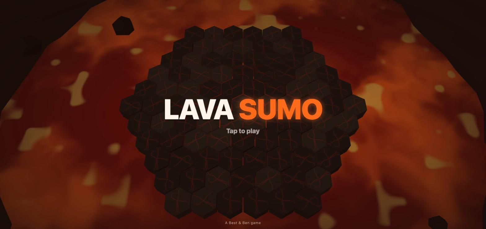 | 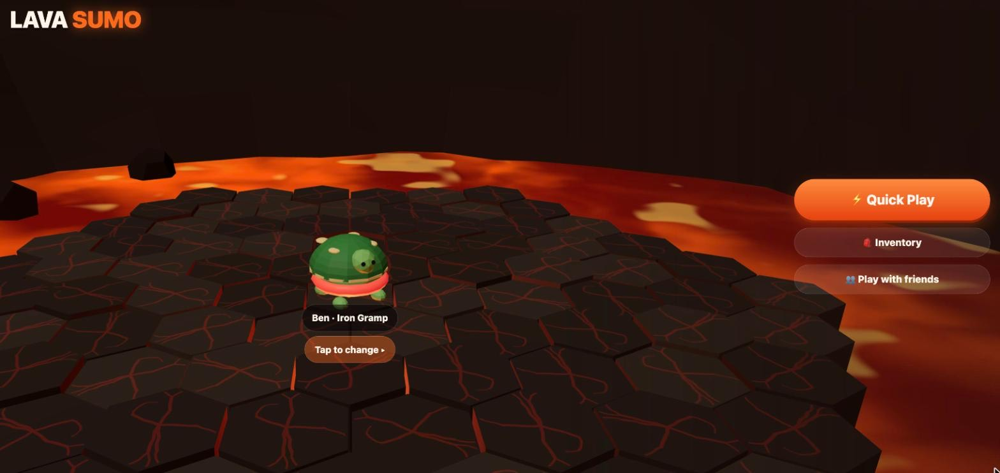 |

### Three fighters, one button each
Each fighter has one skill on one button, so it's easy to learn and still has tactics:

| 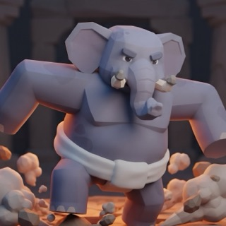 | 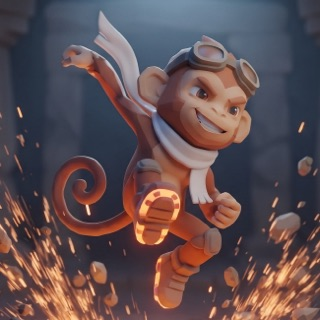 | 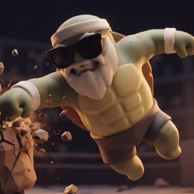 |
|:---:|:---:|:---:|
| **Magma Tank** (elephant, tank) | **Ember Dash** (monkey, speedster) | **Iron Gramp** (turtle, anchor) |
| *Ground Slam* knocks everyone nearby away | *Dash* is a quick lunge to shove someone off | *Shell* makes it immovable for 1.5 s, and attackers bounce off |

The fighters started as placeholder emoji (🐘 🐒 🐢) so the gameplay could be tested first. Once the roles felt right, I gave each one a name and a portrait that says its role at a glance: a heavy stomper, a grinning daredevil, and a tough old grandpa who doesn't budge. Each portrait is compressed to about 25 KB, so the art adds almost nothing to the download on mobile data.

| Inventory | Quick Play setup |
|---|---|
| 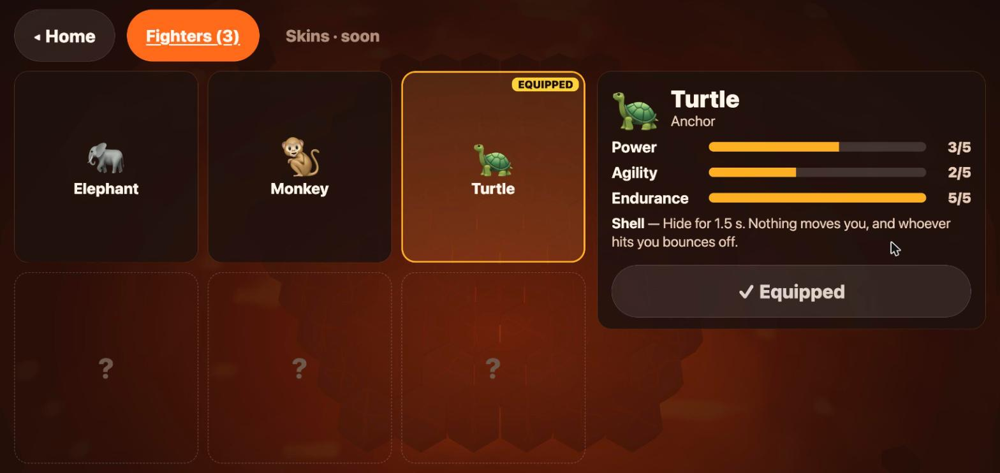 | 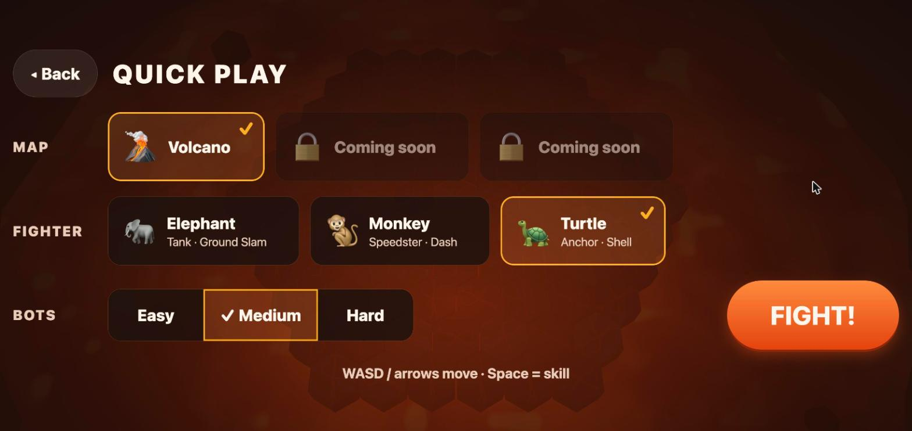 |

### A match that tells a story in 90 seconds
The floor shrinks from the edge, random tiles crack and sink, a **volcano eruption** marks danger circles mid-match, and **sudden death** clears the last ring. Eliminated players aren't bored: they become ember spirits that throw lava rocks at the survivors.

| In a match | Results |
|---|---|
|  | 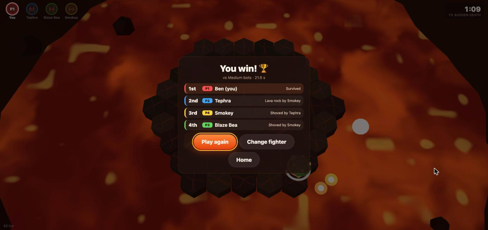 |

The results screen shows **how** each player went out ("Shoved by Smokey", "Lava rock by Smokey"). That gives the group something to talk about and a reason to rematch.

### Play with friends (online)
Create a room, share a 4-letter code or link, and friends land straight in your lobby. Empty seats are filled by bots, so 2 friends can still play a full 4-player match.

| Create or join | Lobby (host view) |
|---|---|
| 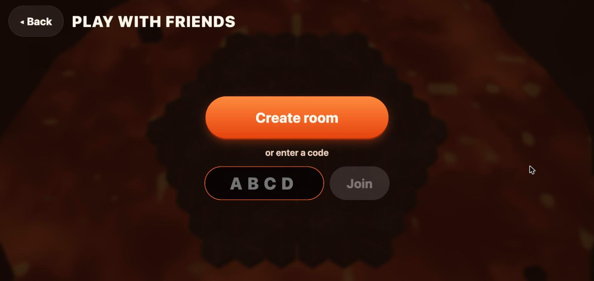 | 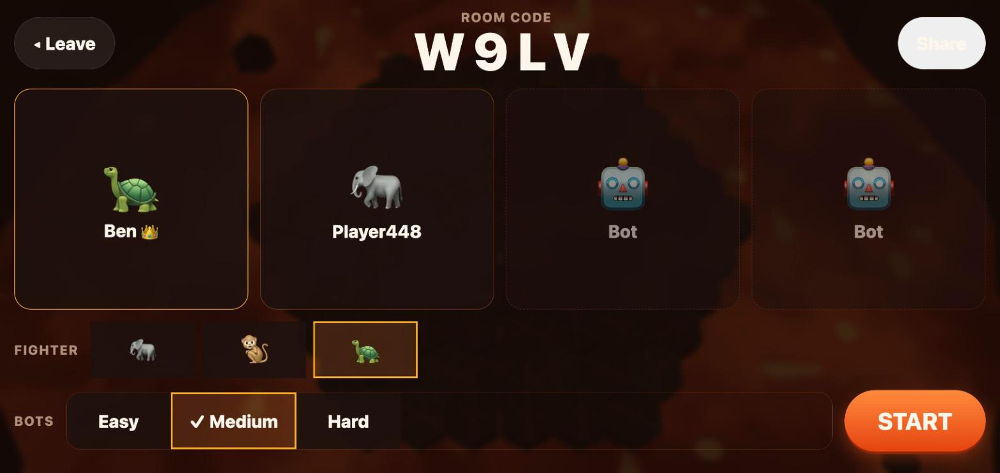 |

**Same match, two different players' screens.** Each player sees "You" on their own fighter, and the floor and positions match because the server is the single source of truth:

| Player 1 (host) | Player 2 (guest) |
|---|---|
| 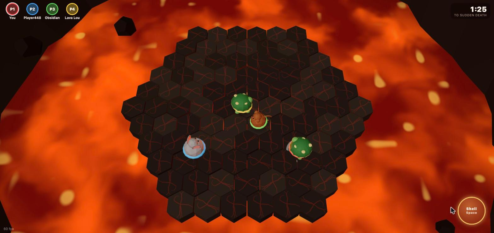 | 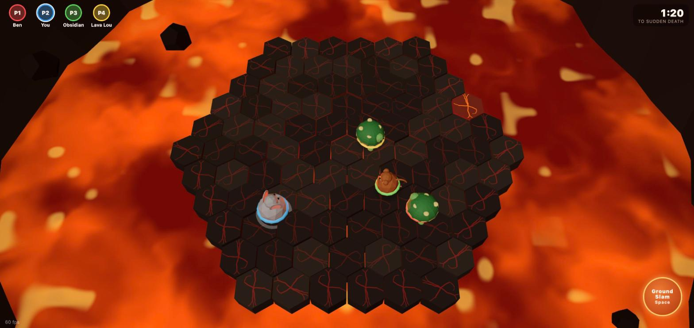 |

---

## 3. How I ran it: Product Owner + AI agents

I treated the AI like an engineering team that's fast but needs very clear direction. My job was to make sure it built the **right** thing and could prove it worked.

```
  Spec (what & why)  →  Design doc per feature  →  Plan: small tasks with tests
        ↑                                                   ↓
  Decision log  ←  Playtest & measure  ←  Build: 1 agent per task + independent review
```

1. **Spec first.** [`SPEC.md`](../../SPEC.md) holds the requirements, non-functional targets (fps, latency, cost) and decision records *before* any code.
2. **A design doc per feature.** For each milestone I approved a short design: goals, **non-goals**, **anti-goals** (what would be a failure even if it "works"), and the options considered. Example: [online multiplayer design](../superpowers/specs/2026-11-19-online-multiplayer-design.md).
3. **Small, testable tasks.** Each plan broke the work into tasks, each with its own tests. A fresh agent built each task, and a separate reviewer agent checked it against the spec before the next one started.
4. **Every judgment call written down.** When the spec didn't settle something, the decision, the reason and *the cost if wrong* went into the log, so I could review and reverse any of them.
5. **Gates I kept for myself.** Nothing goes live, merges, or costs money without my explicit OK. Builds go to a **test environment** first, which I play before anything reaches the live site.

---

## 4. Key product decisions and trade-offs

| Decision | Options considered | Chose | Why / trade-off |
|---|---|---|---|
| **Hosting the game server** | Fly.io (~$2–5/mo, card required) · Render free tier (sleeps, ~1 min cold start) · **Cloudflare Workers + Durable Objects** | Cloudflare | **$0 with no card**, no cold start, servers near both US and Thailand players. Cost: no ready-made game framework, so we built rooms, syncing and reconnection ourselves (small and fully tested). |
| **How phones stay in sync** | Every phone runs the game (lockstep) · server decides + phones replay (snapshots) · snapshots + local prediction | **Server snapshots** | Lockstep risks phones disagreeing on who fell (different browsers do float math differently): that was an **anti-goal**. Prediction is better for feel but more complex, so it was **deferred until testers report lag**. |
| **Play with bots first, multiplayer second** | Build online first · **solo first** | Solo first | Solo needs no server, so it could go live in days and get real feedback. The game logic was written once and shared by phone and server, so the online version reused it unchanged. |
| **Bots fill empty seats** | Wait for 4 humans · **bots fill** | Bots | A group of 2 can still play a full, chaotic 4-player match. That fits the "play right now" goal. |
| **Two environments** | Test on the live site · **separate test + live** | Separate | Friends can try risky builds on a test link with a **TEST** badge while the public link stays stable. |
| **Rooms by link, not accounts** | Accounts and friend lists · **room code + link** | Link | Accounts add friction for no gain in a private party game. The share link is the invite. |
| **Match length kept at 90 s** | Spec's original floor-collapse speed · **slower collapse** | Slower | Measured: the original rates emptied the floor in ~45 s, so "90-second matches" was false. I retuned the rates so the eruption and sudden death actually happen. |

The full log has about 20 more, each with its reason: [`DECISIONS.md`](../../DECISIONS.md).

---

## 5. Data over opinions

### Difficulty that actually feels different
Before shipping bot difficulties I had the computer play **200 matches per pairing** and checked that each level reliably beats the one below:

| Pairing | Stronger side wins |
|---|---|
| Hard vs Easy | **95.9%** |
| Hard vs Medium | **76.8%** |
| Medium vs Easy | **79.0%** |

Tried and dropped, because the data said so: two "smarter" bot behaviors made Hard bots *more passive* and **lowered** their win rate.

### Fighter balance: measured, shipped, then fixed from playtest
The simulation flagged that **Ember Dash (the monkey) won 68% of Hard-bot matches** (fair would be ~33%). I **chose to ship anyway** and let real players confirm it. Every tuning option that fixed it changed a core feel decision, and I didn't want to tune for bots instead of people.

The first playtest confirmed it ("Monkey's skill is too good", from before the fighters had names), so I compared three fixes in simulation:

| Option | Ember Dash win share (600 matches, Hard bots) |
|---|---|
| Original (6 s cooldown) | 68.0% |
| 8 s cooldown | 64.1% |
| 8 s cooldown + shorter dash | 63.0% |
| **10 s cooldown (shipped to test)** | **57.6%** |

The data also showed one-on-one Ember Dash still wins about 98%, so the next lever, if needed, is the dash's knockback and not the cooldown.

---

## 6. Playtest → diagnose → fix

After the first test-environment playtest I got three reports. Each was diagnosed before anything was changed:

| Report | Diagnosis | Action |
|---|---|---|
| "The stadium is too dark on my phone" | On a phone held upright, the camera pulls back to fit the arena (42 m vs 18 m), and the fixed fog covered the whole stage | Fog now scales with camera distance, and touch screens get slightly brighter rendering. **Fixed same day.** |
| "Monkey's skill is too good" | Confirmed by simulation (above) | Cooldown 6 s → 10 s. **Fixed same day.** |
| "It lags on my laptop" | **Measured** the live test server: updates arrive in bursts (gaps up to 136 ms vs 50 ms expected), and your own fighter waits ~¼ s for a server round trip | Split into a quick fix (smooth the updates) and a bigger one (instant local movement, the "prediction" deferred earlier). **Both shipped:** in a latency simulation, press → move dropped from ~320–430 ms to ~50–70 ms. |

The lag report is the trigger I'd set in advance for building prediction: I deferred it as "only if testers report lag", and now they have.

---

## 7. Quality and engineering health

- **229 automated tests** cover the game rules, bots, room logic, the online sync format and the screens. Every change runs them.
- **One rulebook for phone and server:** the game logic is a single shared package with no randomness or clocks hidden inside, so the server and every phone compute the same match from the same inputs.
- **Every tuning number lives in one file** (`config.ts`), so balance changes are one-line, reviewable edits.
- **Independent review:** each task was checked by a separate reviewer against the spec. Issues found in review (examples: a reconnecting player got a stale screen, a silent background tab kept steering its fighter) were fixed before merge.
- **Resilience built in:** reconnect within 15 s keeps your seat (a bot drives it meanwhile), spam protection on the server, rooms clean themselves up, and solo mode keeps working even if the server is down.

---

## 8. What's next

| Now | Next | Later |
|---|---|---|
| Playtest online with bigger friend groups, on cellular | Optional accounts so stats follow you across devices (designed) | Analytics (rematch rate, matches per session) to measure against the traction gate |
| Re-check Ember Dash balance with real players | 3D fighter models that match the new portraits | More arenas (the map picker already has slots), skins |

---

## 9. What I learned as a PM working with AI agents

- **Clarity is the bottleneck, not coding speed.** The agents wrote code fast. The quality came from precise specs, explicit non-goals and acceptance tests.
- **Write anti-goals.** "Two phones show different winners" ruled out a whole technical approach before it cost anything.
- **Defer with a trigger, not a shrug.** "Add prediction *only if testers report lag*" made the later decision obvious when it happened.
- **Measure before you tune.** The "lag" turned out to be two different problems with two different fixes, and the "dark screen" came from fog and camera distance, not lighting.
- **Keep the irreversible decisions human.** Going live, merging and spending money always waited for my OK. Everything else the agents could decide, as long as it was written down and reversible.

---

*Built with Claude Code. Tech: TypeScript, Three.js, Vite, Cloudflare Workers + Durable Objects, GitHub Pages, Vitest.*
